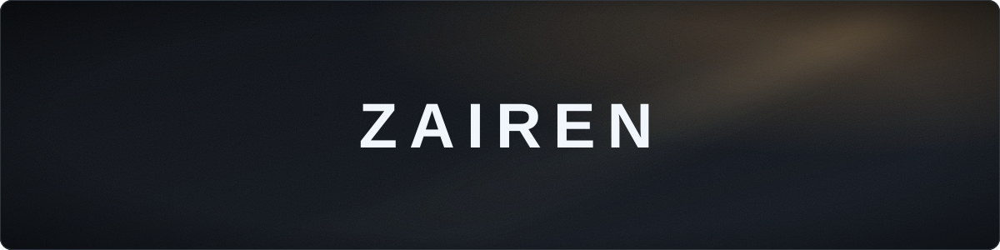

Co-founder of **[Go Studios](https://gostudios.dev)**. We make games on Roblox. 
I work on gameplay systems, enemy AI, lighting and performance.

<!-- More links go on this line, e.g. a Roblox profile:

-->

